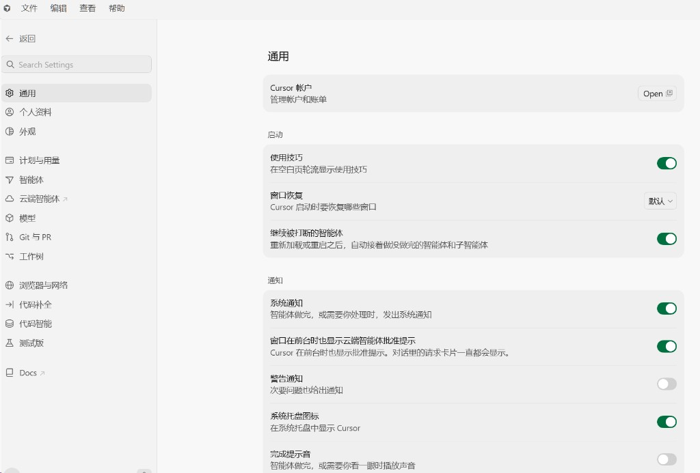
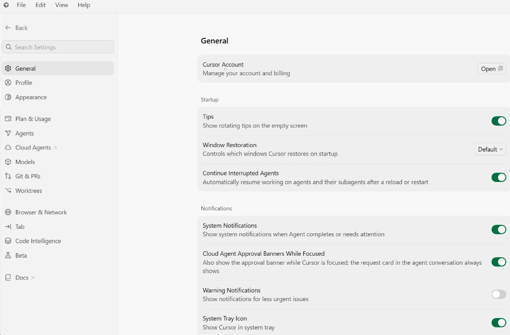

# Cursor Language Pack

Cursor 中文语言包，支持简体中文和繁体中文，覆盖编辑器、设置和智能体界面。

[English](https://github.com/polang233/cursor-language-pack/blob/main/docs/README.en.md)

<p align="center">
  
</p>
<p align="center">
  <a href="https://open-vsx.org/extension/polang233/cursor-language-pack"></a>
  <a href="https://www.npmjs.com/package/@polang233/cursor-language-pack"></a>
  <a href="https://github.com/polang233/cursor-language-pack/stargazers"></a>
  <a href="https://github.com/polang233/cursor-language-pack/releases/latest"></a>
</p>

| 简体中文设置 | 英文设置 |
| --- | --- |
|  |  |


## 命令行安装

推荐 Node.js 22+，最低 18.17。先完全退出 Cursor。

```bash
npx @polang233/cursor-language-pack@latest
```

默认执行 `install`，安装语言包并翻译程序内的文案。包内自带本版本 VSIX，无需下载源码或构建。手动切换语言，或指定安装目录：

```bash
npx @polang233/cursor-language-pack@latest --locale=zh-cn
npx @polang233/cursor-language-pack@latest --locale=zh-tw
npx @polang233/cursor-language-pack@latest --dir="安装目录"
```

| 子命令 | 用途 |
| --- | --- |
| `preview` | 预览改动 |
| `status` | 查看状态 |
| `restore` | 只恢复程序文件 |

系统语言为 TW/HK/MO 或 zh-Hant 时自动选 `zh-tw`，其他选 `zh-cn`。可用 `--locale` 指定。`--dir` 指向含 `resources/app` 的安装目录，macOS 为 `Cursor.app/Contents`。

安装后重新打开 Cursor；应用更新后重跑安装命令。扩展和显示语言可在应用内切换，`restore` 不会卸载扩展或重置显示语言。

可在仓库内联调源码入口，准备步骤见 [npm 维护说明](https://github.com/polang233/cursor-language-pack/blob/main/docs/npm.md)：

```bash
node bin/cli.mjs preview --locale=zh-tw
```

## 扩展安装

1. 卸载其他语言包，避免与官方 VS Code 中文包冲突。
2. 在扩展中搜索 **Cursor Language Pack** 或 **汉化**，也可从 [GitHub Releases](https://github.com/polang233/cursor-language-pack/releases) 下载 VSIX，通过 **Extensions: Install from VSIX…** 安装。
3. 命令面板运行 **Language Pack: Select Display Language**，选简体或繁体，完全退出 Cursor 后重新打开。

扩展 id 保持 `polang233.cursor-language-pack`。也可用设置 `cursorLanguagePack.language` 选择 `auto`、`zh-cn`、`zh-tw` 或 `en`，切换后重启。仅安装扩展时，部分写死在程序里的英文需要命令行安装才能翻译。

当前译文对应 Cursor **3.29.15**。新增或未覆盖的文案会显示英文。Cursor 和 MCP 等名称保留英文。

## 开发与许可

[维护与源码测试](https://github.com/polang233/cursor-language-pack/blob/main/docs/npm.md) · [发布](https://github.com/polang233/cursor-language-pack/blob/main/docs/publishing.zh-CN.md) · [架构](https://github.com/polang233/cursor-language-pack/blob/main/docs/architecture.zh-CN.md) · [贡献](https://github.com/polang233/cursor-language-pack/blob/main/docs/CONTRIBUTING.md)

MIT。工作台译文来自 [microsoft/vscode-loc](https://github.com/microsoft/vscode-loc)，见 [NOTICE](https://github.com/polang233/cursor-language-pack/blob/main/NOTICE)。社区项目，与 Anysphere、Microsoft 无隶属关系。
