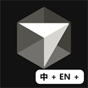

# Cursor Language Pack — 中文 / 日本語

<p align="center">
  
</p>
<p align="center">
  <a href="https://open-vsx.org/extension/polang233/cursor-language-pack"></a>
  <a href="https://www.npmjs.com/package/@polang233/cursor-language-pack"></a>
  <a href="https://github.com/polang233/cursor-language-pack/stargazers"></a>
  <a href="https://github.com/polang233/cursor-language-pack/releases/latest"></a>
</p>

**Cursor 的多语言工具包（汉化 / 中文翻译）。** 支持简体中文、繁体中文和日语。

安装本扩展可翻译编辑器界面。设置页、智能体和账号页的部分文案需要运行下方的一键安装命令。

## 编辑器界面翻译

安装扩展后，菜单、文件、编辑器和终端使用所选语言。设置页、智能体和账号页的部分文案需通过命令行翻译。

1. 先卸载其他语言包，避免工作台译文冲突。
2. 在扩展中搜索 **Cursor Language Pack**、**汉化** 或 **日本語**，安装。
3. 命令面板 → **Language Pack: Select Display Language** → 选 **中文（简体）**、**中文（繁體）** 或 **日本語** → **完全退出 Cursor 再打开**。

换语言不用重装，改 `cursorLanguagePack.language`（`auto` / `zh-cn` / `zh-tw` / `ja` / `en`）后同样要重启。选 `en` 回到英文。

## 全局翻译

完全退出 Cursor，在终端运行：

```bash
npx @polang233/cursor-language-pack@latest
```

推荐 Node.js 22+，最低 18.17。日语系统默认日语，TW/HK/MO 或 zh-Hant 默认繁体，其他默认简体。可用 `--locale=ja`、`--locale=zh-cn` 或 `--locale=zh-tw` 手动切换。安装后重新打开 Cursor，应用更新后重跑命令。[更多命令](https://github.com/polang233/cursor-language-pack#readme)。

## 其他语言 / Other languages

支持简体、繁体和日语。欢迎贡献韩语、法语、德语、西班牙语等其他语言。未翻译的键显示英文。

Available: `zh-cn`, `zh-tw`, `ja`. Contributions for more languages are welcome.

贡献: [polang233/cursor-language-pack](https://github.com/polang233/cursor-language-pack)

## 隐私 / Privacy

只在你确认后写 `argv.json` 的 `locale`。不联网，不采集。

## 许可 / License

MIT. 工作台译文来自 MIT 许可的 [microsoft/vscode-loc](https://github.com/microsoft/vscode-loc)。

社区项目，与 Anysphere、Microsoft 无隶属关系。

文档: [English](https://github.com/polang233/cursor-language-pack/blob/main/docs/README.en.md) · [简体中文](https://github.com/polang233/cursor-language-pack#readme) · [日本語](https://github.com/polang233/cursor-language-pack/blob/main/docs/README.ja.md)
