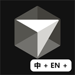

# Cursor Language Pack — 简体中文 / 繁體中文

<p align="center">
  
</p>
<p align="center">
  <a href="https://open-vsx.org/extension/polang233/cursor-language-pack"></a>
  <a href="https://www.npmjs.com/package/@polang233/cursor-language-pack"></a>
  <a href="https://github.com/polang233/cursor-language-pack/stargazers"></a>
  <a href="https://github.com/polang233/cursor-language-pack/releases/latest"></a>
</p>

**Cursor 的多语言工具包（汉化 / 中文翻译）。** 目前支持简体中文和繁体中文。

安装本插件，可以把编辑器界面翻译成中文。设置页、智能体和账号页的部分文案需要运行下方的一键安装命令。

## 只汉化 VS Code 部分

装扩展即可。菜单、文件、编辑器、终端会变成中文。设置页、智能体窗口、账号页里写死的英文不会变。

1. 先卸载其他语言包。本扩展替代 VS Code 官方中文语言包，不要两个一起装。
2. 扩展里搜索 **汉化** 或 **中文语言包**，安装。
3. 命令面板 → **Language Pack: Select Display Language** → 选 **中文（简体）** 或 **中文（繁體）** → **完全退出 Cursor 再打开**。

换语言不用重装，改 `cursorLanguagePack.language`（`auto` / `zh-cn` / `zh-tw` / `en`）后同样要重启。选 `en` 回到英文。

## 全局翻译

完全退出 Cursor，在终端运行：

```bash
npx @polang233/cursor-language-pack@latest
```

推荐 Node.js 22+，最低 18.17。系统语言为 TW/HK/MO 或 zh-Hant 时默认繁体，其他默认简体。追加 `--locale=zh-cn` 或 `--locale=zh-tw` 可手动切换。安装后重新打开 Cursor，应用更新后重跑命令。[更多命令](https://github.com/polang233/cursor-language-pack#readme)。

## 其他语言 / Other languages

简体和繁体已经发布。日语、韩语、法语、德语、西班牙语等已在仓库里预留，**还没有译文**，需要对应语言的用户自己翻、提 PR。没翻的键显示英文。

Shipped: `zh-cn`, `zh-tw`. Other locales are declared in the repo and waiting for translations.

贡献: [polang233/cursor-language-pack](https://github.com/polang233/cursor-language-pack)

## 隐私 / Privacy

只在你确认后写 `argv.json` 的 `locale`。不联网，不采集。

## 许可 / License

MIT. 工作台译文来自 MIT 许可的 [microsoft/vscode-loc](https://github.com/microsoft/vscode-loc)。

社区项目，与 Anysphere、Microsoft 无隶属关系。

文档: [English](https://github.com/polang233/cursor-language-pack/blob/main/docs/README.en.md) · [简体中文](https://github.com/polang233/cursor-language-pack#readme)
